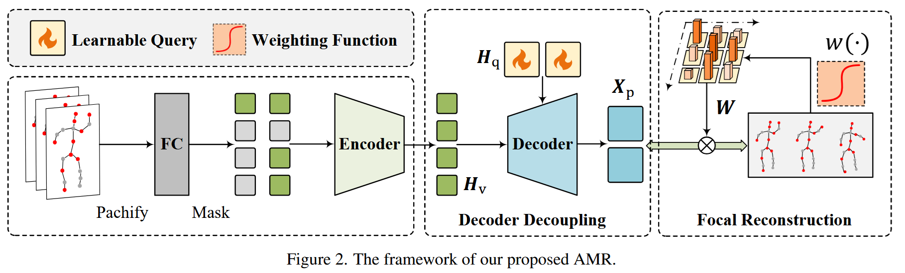

# Exploring Adaptive Masked Reconstruction for Self-Supervised  Skeleton-Based Action Recognition

Official PyTorch implementation of **AMR** (CVPR 2026).

Paper Link: [[CVPR 2026]](https://openaccess.thecvf.com/content/CVPR2026/html/Sun_Exploring_Adaptive_Masked_Reconstruction_for_Self-Supervised_Skeleton-Based_Action_Recognition_CVPR_2026_paper.html)      [[arXiv]](https://arxiv.org/abs/2606.11450)



## Setup

```bash
pip install -r requirements.txt
```

Datasets are expected as `.npz` files following the preprocessing of
[MAMP](https://github.com/maoyunyao/MAMP) (`data/ntu`, `data/ntu120`,
`data/pku_v2` contain the generation scripts). Update `data_path` in
`config/*.yaml` to point to your local copies.

## Data Preparation

### 1. Download the raw datasets

**NTU RGB+D 60 / 120**

1. Request access at https://rose1.ntu.edu.sg/dataset/actionRecognition
2. Download the skeleton-only files:
   - `nturgbd_skeletons_s001_to_s017.zip` (NTU RGB+D 60)
   - `nturgbd_skeletons_s018_to_s032.zip` (NTU RGB+D 120 extra setups)
3. Extract them into `data/nturgbd_raw/` so that the `.skeleton` files live in:
   - `data/nturgbd_raw/nturgb+d_skeletons/` (setups S001–S017)
   - `data/nturgbd_raw/nturgb+d_skeletons_120/` (setups S018–S032)

**PKU-MMD v2**

1. Request access at the [PKU-MMD project page](http://39.96.165.147/Projects/PKUMMD/PKU-MMD.html)
2. Download `Skeleton_v2.7z`, `Label_PKUMMD_v2.7z`, `cross_subject_v2.txt`,
   `cross_view_v2.txt` (Phase II)
3. Extract into `data/pku_raw/v2/` with `skeleton/`, `label/` subfolders and
   the two split txt files alongside them.

Expected directory layout:

```
- data/
  - ntu/                     # NTU60 generation scripts (+ statistics/)
  - ntu120/                  # NTU120 generation scripts (+ statistics/)
  - pku_v2/                  # PKU-MMD v2 generation script
  - nturgbd_raw/
    - nturgb+d_skeletons/      # S001–S017 .skeleton files
    - nturgb+d_skeletons_120/  # S018–S032 .skeleton files
  - pku_raw/
    - v2/
      - skeleton/
      - label/
      - cross_subject_v2.txt
      - cross_view_v2.txt
```

### 2. Generate the `.npz` files

**NTU RGB+D 60** — three steps, run from `data/ntu/`:

```bash
cd data/ntu
python get_raw_skes_data.py       # parse .skeleton files -> raw_data/raw_skes_data.pkl
python get_raw_denoised_data.py   # remove bad/noisy skeletons -> denoised_data/
python seq_transformation.py      # center on frame 1, align lengths -> NTU60_{XSub,XView}.npz
```

**NTU RGB+D 120** — identical steps from `data/ntu120/` (setups S018+ are read
automatically from `nturgb+d_skeletons_120/`); produces `NTU120_XSub.npz` and
`NTU120_XSet.npz`.

```bash
cd data/ntu120
python get_raw_skes_data.py
python get_raw_denoised_data.py
python seq_transformation.py
```

**PKU-MMD v2** — single script (generates both XSub and XView splits):

```bash
cd data/pku_v2
python pku_gendata.py             # -> PKUv2_XSub.npz, PKUv2_XView.npz
# or point at a custom raw-data location:
# python pku_gendata.py --data_path /path/to/pku_raw/v2
```

### 3. Point the configs at the generated files

Set `data_path` in
`config/pretrain.yaml`, `config/linprobe.yaml` to the
matching file for each `cfg-name`:

## Configuration

Configs use `_base_` inheritance ([util/yaml_loader.py](util/yaml_loader.py)):
`config/_base_/{pretrain,linprobe}.yaml` hold protocol defaults, while
`config/{pretrain,linprobe}.yaml` list per-dataset overrides selected via
`--cfg-name`:

| cfg-name | dataset | benchmark |
|---|---|---|
| `ntu60_xsub` | NTU RGB+D 60 | cross-subject |
| `ntu60_xview` | NTU RGB+D 60 | cross-view |
| `ntu120_xsub` | NTU RGB+D 120 | cross-subject |
| `ntu120_xset` | NTU RGB+D 120 | cross-setup |
| `pkuv2_xsub` | PKU-MMD v2 | cross-subject |


## Training

Pretrain, then evaluate with regular/fast linear probing.

```bash
# 1. Pretrain (NTU60 xsub by default; change NAME for other datasets/splits)
bash scripts/pretrain.sh

# 2. Regular linear probe
CKPT=output/pretrain_ntu60_xsub/checkpoint-399.pth bash scripts/linprobe.sh

# Or fast linear probe on features extracted once, without data augmentation
CKPT=output/pretrain_ntu60_xsub/checkpoint-399.pth bash scripts/fast_linprobe.sh

```

Reproduced pretrained checkpoints are available in [`checkpoints/`](https://drive.google.com/drive/folders/1WN_tudS_BlAVF5FaW3dj2tgYcjpBiXmZ?usp=drive_link).
Their evaluation results (fast linprobe, seed 0, Top-1 accuracy) are:

| Protocol / checkpoint | Evaluation | Epochs | Top-1 (%) |
|---|---|---:|---:|
| [NTU60 XSub](<checkpoints/ntu60_xsub/checkpoint-399.pth>) | Fast linprobe | 100 | 87.39 |
| [NTU60 XView](<checkpoints/ntu60_xview/checkpoint-399.pth>) | Fast linprobe | 100 | 92.31 |
| [NTU120 XSub](<checkpoints/ntu120_xsub/checkpoint-399.pth>) | Fast linprobe | 100 | 81.35 |
| [NTU120 XSet](<checkpoints/ntu120_xset/checkpoint-399.pth>) | Fast linprobe | 100 | 82.17 |


## Citation
If you find this repository useful, please consider citing our paper:
```
@InProceedings{Sun_2026_CVPR,
    author    = {Sun, Shengkai and Cheng, Zhiyong and Zhang, Zefan and Dong, Jianfeng and Li, Zhihui and Wang, Meng},
    title     = {Exploring Adaptive Masked Reconstruction for Self-Supervised Skeleton-Based Action Recognition},
    booktitle = {Proceedings of the IEEE/CVF Conference on Computer Vision and Pattern Recognition (CVPR)},
    month     = {June},
    year      = {2026},
    pages     = {13974-13983}
}

@article{sun2026exploring,
  title={Exploring Adaptive Masked Reconstruction for Self-Supervised Skeleton-Based Action Recognition},
  author={Sun, Shengkai and Cheng, Zhiyong and Zhang, Zefan and Dong, Jianfeng and Li, Zhihui and Wang, Meng},
  journal={arXiv preprint arXiv:2606.11450},
  year={2026}
}
```

## Acknowledgments

This code is built on top of
[MAE](https://github.com/facebookresearch/mae) and
[MAMP](https://https://github.com/maoyunyao/MAMP).
